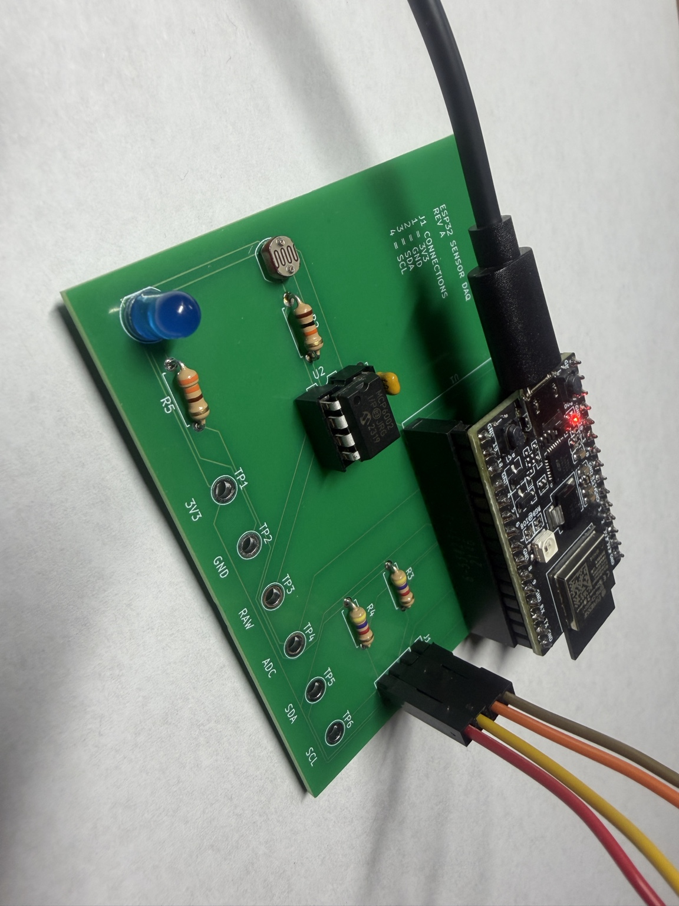
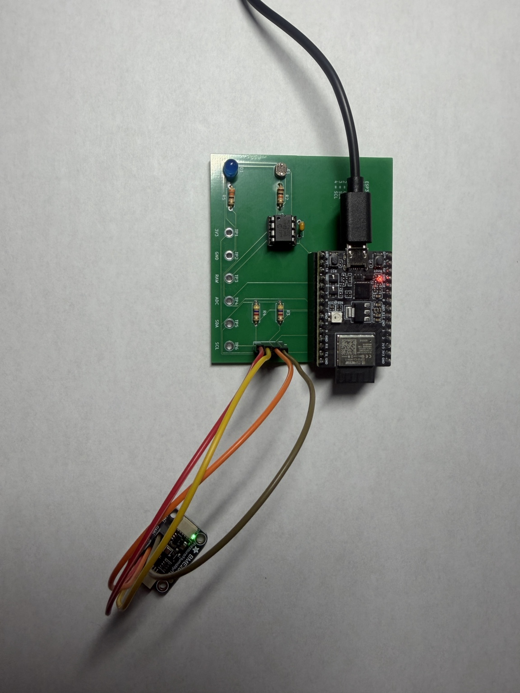
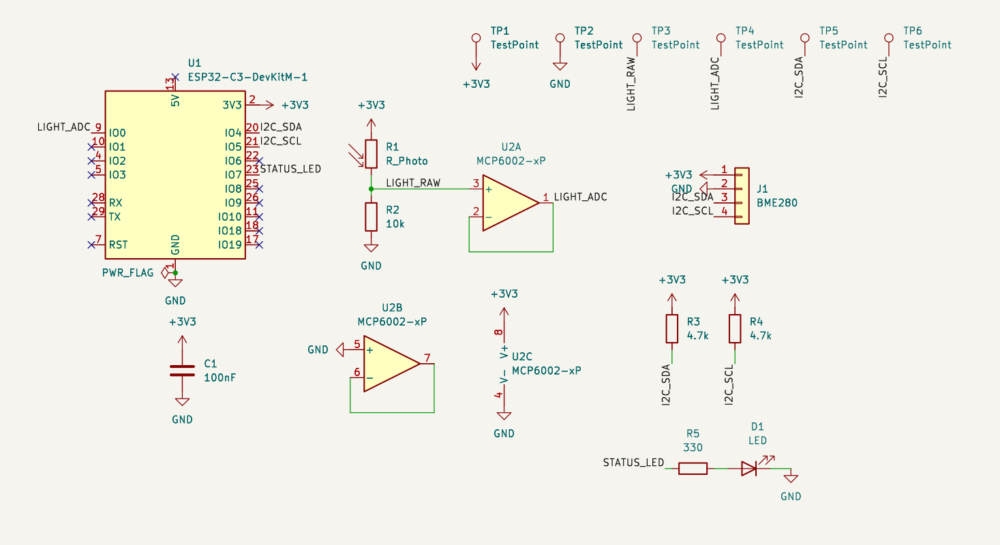

# ESP32 sensor board

Eldin Lozic · Electrical Engineer Intern challenge

I designed this two-layer board in KiCad and assembled it by hand. It uses an ESP32-C3 to read a light sensor and a BME280 breakout for temperature, humidity, and pressure. The readings are sent over USB serial as CSV.

## Finished hardware

## One useful detail

The light sensor uses a photoresistor voltage divider and an MCP6002 op-amp buffer before the ESP32 ADC. I added test points on both sides of the buffer: TP3 (`RAW`) and TP4 (`ADC`).

If the light reading looks wrong, I can measure the signal before and after the buffer. That helps me check where the problem starts without soldering extra wires onto the board.

There are also test points for power and I2C. The ESP32 is socketed so it can be removed, and the through-hole parts are easy to reach for soldering and repairs.

[KiCad schematic source](../hardware/ESP32_Sensor_Data_Acquisition_Board.kicad_sch) · [PCB layout source](../hardware/ESP32_Sensor_Data_Acquisition_Board.kicad_pcb)

## What I tested

The board powered up, the firmware uploaded, and the BME280 was detected over I2C. I got sensor readings over USB serial. The light reading was about 250 ADC counts when covered, around 2000 in room light, and 4095 under a flashlight.

These were basic function checks. Sensor calibration, direct measurements across the buffer, and a longer logging test are still pending.

[Validation record](VALIDATION.md) · [Bring-up procedure](TEST_PLAN.md) · [Firmware](../firmware/ESP32_Sensor_DAQ_Firmware/ESP32_Sensor_DAQ_Firmware.ino)
